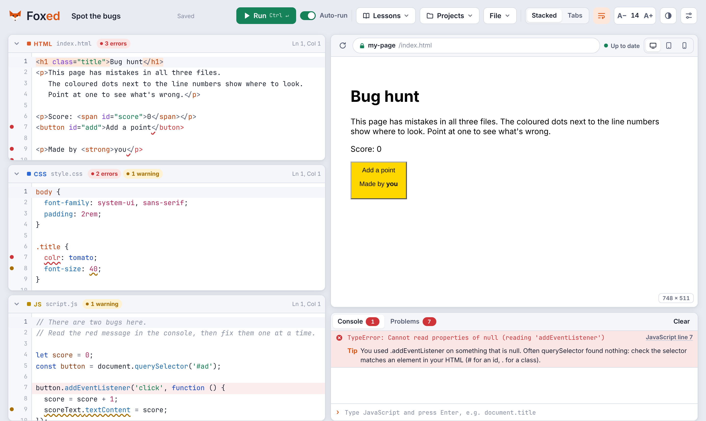

# FoxEd

A simple HTML, CSS and JavaScript editor to teach (and learn) coding.

Students write HTML, CSS and JavaScript side by side and see the result straight away in a built-in browser preview. Mistakes are marked as they type and explained in plain English, so students can fix problems themselves instead of getting stuck.

**[Try FoxEd →](https://colourverse.github.io/Foxed/)**

## Features

### Writing code
- Separate HTML, CSS and JavaScript editors, shown stacked or as tabs
- Colour coding, line numbers, line wrapping, and matching brackets and tags
- Adjustable text size for projectors
- Light and dark themes

### Code completion
Suggestions appear as you type and only show what makes sense at that point:
- **HTML:** tags, then only the attributes that belong to that tag, then only that attribute's allowed values (`type` → `text`, `email`, `password`…). `class=""` suggests classes from your CSS, and `for=""` suggests ids on the page.
- **CSS:** property names, then only the values that are valid for that property, checked against the browser's own CSS engine. Typing a number suggests units that property accepts (`10px`, `10rem`, `10%`). Selectors suggest the classes and ids in your HTML.
- **JavaScript:** names from your own code, built-ins, and members of common objects (`console.`, `Math.`, `classList.`, `el.style.`). Inside `querySelector('…')` it suggests real ids and classes from your HTML, and inside `addEventListener('…')` it suggests event names.
- **Shortcuts:** in HTML, type `ul>li*3` or `!` and press Tab to expand them into full tags.

### Error trapping
- Problems are checked as you type and marked with coloured dots by the line numbers and wavy underlines. Red means it won't work; yellow means it's worth a second look.
- Every message comes with a plain-English tip, such as *"Unknown property 'colr'. Did you mean 'color'?"* or *"Numbers need a unit here, like 40px."*
- Errors from the running page appear in the console with an explanation and a link to the exact line.
- A loop that never ends is stopped after 2 seconds instead of freezing the browser tab.
- With auto-run on, the preview waits while the JavaScript has a red error, so half-typed code doesn't fill the console with noise.

### Browser preview and console
- A browser-style preview with an address bar, a reload button and the page title
- Desktop, tablet (768px) and phone (375px) sizes for teaching responsive design
- A console that shows `console.log()` output, with a box for running JavaScript on the page

### Lessons and projects
- Seven starter lessons: Hello web, a profile card, a click counter, a bouncing ball, a responsive layout, a **Spot the bugs** debugging exercise, and a blank page
- Each lesson opens as a new project, and "Reset to starting code" puts it back how it began
- Work saves automatically in the browser
- Download any project as a single `.html` file, or open an existing `.html` file to split it into HTML, CSS and JavaScript

## Using FoxEd in class

FoxEd is one self-contained file, `index.html`. There's nothing to install and no build step.

- **Online:** host it on GitHub Pages (below) or any school web server and give students the link.
- **Offline:** open `index.html` straight from a computer. It needs an internet connection the first time, to load the code editor from a CDN.

Projects are saved in each student's own browser. To hand in work, or move it to another computer, students use **File → Download as .html**.

### Keyboard shortcuts

| Shortcut | Action |
| --- | --- |
| Ctrl + Enter | Run |
| Ctrl + S | Save now |
| Ctrl + Space | Show suggestions |
| Ctrl + / | Comment or uncomment lines |
| Tab | In HTML, expand `ul>li*3` or `!` into tags |

On a Mac, use Cmd instead of Ctrl.

## Hosting on GitHub Pages

1. In this repository, go to **Settings → Pages**.
2. Under "Build and deployment", choose **Deploy from a branch**, then select `main` and `/ (root)`.
3. Save. After a minute or so FoxEd is live at `https://colourverse.github.io/Foxed/`.

## Planned features

- A library of useful code snippets
- React support
- Share links so teachers can send code straight to students

## Built with

FoxEd runs entirely in the browser and uses these open-source libraries, loaded from [jsDelivr](https://www.jsdelivr.com/):

- [CodeMirror 5](https://codemirror.net/5/): the code editor
- [JSHint](https://jshint.com/): JavaScript checking
- [HTMLHint](https://htmlhint.com/): HTML checking
- [Acorn](https://github.com/acornjs/acorn): reads JavaScript so runaway loops can be stopped

CSS is checked by FoxEd itself, using the browser's built-in CSS engine.

## License

Released under the [MIT License](LICENSE).
